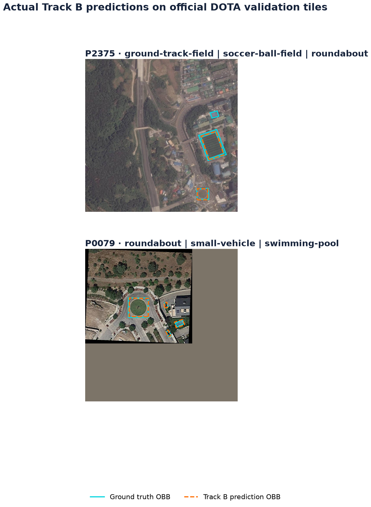

# DOTA v2.0 Oriented Faster R-CNN Benchmark

Internship project (Aeronautical Development Agency): oriented (rotated) object
detection on the full 18-class **DOTA v2.0** dataset using the OpenMMLab
**MMRotate** framework. Two Faster R-CNN tracks were built, trained and
benchmarked under the `le90` oriented-bounding-box convention.

## Dataset access and license

This repository contains the preparation and evaluation code, not the DOTA
image archives. Obtain DOTA v2.0 from the [official DOTA dataset page](https://captain-whu.github.io/DOTA/dataset.html)
and follow its academic-use terms and the image-source terms. Local archives,
tiles, and annotations are intentionally excluded from GitHub.

## Results at a glance

**Track B (flagship), epoch 24 — best checkpoint `best_dota_mAP_epoch_24.pth`**
Official DOTA v2.0 val split (593 images, 7,122 patches, 18 classes).

| | dota/mAP (mmengine) | mAP50 (ext, d0) | mAP50-95 | F1 | Precision | Recall |
| :--- | :---: | :---: | :---: | :---: | :---: | :---: |
| Track A (baseline) | 0.5412 | 0.6049 | 0.3146 | 0.7849 | 0.8157 | 0.7564 |
| **Track B (official val)** | **0.6352** | **0.6968** | **0.4175** | **0.8502** | **0.8711** | **0.8302** |

Scale AP50 (small / medium / large): **0.609 / 0.684 / 0.814** · Angle error (elongated TPs): **2.05 deg** (mean) / 1.45 deg (median) · F1-optimal confidence: **0.8279** · validation: 5.70 img/s @ 4.20 GiB peak VRAM · 49.0 M params

Full write-up: [`docs/ADA_REPORT_S_S_GOKULA_SWAMY.pdf`](docs/ADA_REPORT_S_S_GOKULA_SWAMY.pdf)

- **Track A (baseline)** — Rotated Faster R-CNN, ResNet-50 + FPN, Smooth-L1 loss, 12 epochs.
- **Track B (flagship)** — Oriented R-CNN, ConvNeXt-Small + PAFPN, Gaussian KLD loss, ClassBalancedDataset, 24 epochs.

Training was run in two phases:

| Phase | Hardware | What happened |
| :--- | :--- | :--- |
| 1 | NVIDIA A100-SXM4-80GB (Colab) | Track A (12 ep) + Track B epochs 1–16; official val data (HuggingFace) |
| 2 | 2× NVIDIA Tesla T4 (Kaggle, 12h sessions) | Track B epochs 17–24, resumed from epoch-16 checkpoint |
| Eval | local GPU | Official-val re-evaluation of `best_dota_mAP_epoch_24.pth` — no retraining (see [Data source correction](#data-source-correction)) |

## Final results (official val evaluation)

Official DOTA v2.0 val split, 593 images → 7,122 tiled 1024×1024 patches,
81,048 instances (69,542 non-difficult, 70,561 difficult). Track A = Phase 1
(A100, same tiling). Track B = official val re-evaluation of
`best_dota_mAP_epoch_24.pth` (no retraining).

| Metric | Track A (baseline) | Track B (flagship, epoch 24) |
| :--- | :---: | :---: |
| Official dota/mAP (mmengine, 18-class macro, diff-included) | 0.5412 | **0.6352** |
| Extended evaluator mAP50 (non-difficult GT) | 0.6049 | **0.6968** |
| Strict mAP50-95 | 0.3146 | **0.4175** |
| AP75 | 0.2785 | **0.4347** |
| Precision (F1-optimal, conf = 0.8279) | 0.8157 | **0.8711** |
| Recall (F1-optimal, conf = 0.8279) | 0.7564 | **0.8302** |
| F1-score (F1-optimal, conf = 0.8279) | 0.7849 | **0.8502** |
| Scale AP50 (small/med/large) | 0.4875 / 0.5882 / 0.6602 | **0.6089 / 0.6844 / 0.8135** |
| Mean angle error (all TPs) | 3.78 deg | **4.83 deg mean / 1.56 deg median** |
| Mean angle error (elongated TPs) | 2.55 deg | **2.05 deg mean / 1.45 deg median** |
| Easy / Difficult GT recall | 0.7565 / 0.2631 | **0.8303 / 0.299** |
| F1-optimal confidence threshold | — | 0.8279 |
| Validation throughput | 17.38 FPS (Phase 1) | 5.70 img/s |
| Peak GPU memory | 28.04 GiB (Phase 1) | 4.20 GiB |

**Two mAP conventions.** mmengine `DOTAMetric` reports `dota/mAP: 0.6352`
(18-class macro, IoU 0.5, `diff_thr=100` — includes difficult GT). The extended
evaluator reports `mAP50: 0.6968` on non-difficult GT only. Both conventions
were used in Phase 1; the extended d0-only number is the apples-to-apples
comparison vs Track A. **Difficult recall** (0.299) is measured against 70,561
officially-difficult instances — genuinely tiny, occluded, or ambiguous boxes.
The metrics here are from labeled validation data; no hidden-label DOTA server
score is claimed.

## Per-class breakdown (AP50, recall @ F1-optimal)

Track A = Phase 1 (official val, A100). Track B = official val, `best_dota_mAP_epoch_24`.
Extended evaluator, non-difficult GT. #GT = non-difficult occurrences.

| Class | #GT | Track A (AP / Recall) | Track B (AP / Recall) | ΔAP |
| :--- | :---: | :---: | :---: | :---: |
| plane | 3,976 | 0.809 / 0.876 | **0.936 / 0.908** | +0.127 |
| baseball-diamond | 357 | 0.664 / 0.858 | **0.757 / 0.840** | +0.093 |
| bridge | 745 | 0.374 / 0.586 | **0.557 / 0.579** | +0.183 |
| ground-track-field | 192 | 0.690 / 0.883 | **0.798 / 0.755** | +0.108 |
| small-vehicle | 21,258 | 0.417 / 0.492 | **0.822 / 0.810** | +0.405 |
| large-vehicle | 9,118 | 0.676 / 0.802 | **0.869 / 0.803** | +0.193 |
| ship | 23,075 | 0.776 / 0.801 | **0.911 / 0.889** | +0.135 |
| tennis-court | 1,414 | 0.901 / 0.934 | **0.957 / 0.926** | +0.056 |
| basketball-court | 242 | 0.596 / 0.702 | **0.762 / 0.731** | +0.166 |
| storage-tank | 3,273 | 0.600 / 0.638 | **0.829 / 0.801** | +0.229 |
| soccer-ball-field | 103 | 0.536 / 0.745 | **0.672 / 0.641** | +0.136 |
| roundabout | 278 | 0.603 / 0.778 | **0.763 / 0.763** | +0.160 |
| harbor | 4,102 | 0.552 / 0.697 | **0.803 / 0.783** | +0.251 |
| swimming-pool | 1,195 | 0.556 / 0.681 | **0.669 / 0.679** | +0.113 |
| helicopter | 116 | 0.542 / 0.633 | **0.669 / 0.569** | +0.127 |
| container-crane | 27 | 0.000 / 0.000 | **0.032 / 0.074** | +0.032 |
| airport | 67 | 0.450 / 0.598 | **0.488 / 0.582** | +0.038 |
| helipad | 4 | 0.000 / 0.000 | **0.250 / 0.500** | +0.250 |

**Low-support classes.** Container-crane (27 GT), airport (67), and helipad (4)
have very few instances; their AP should be interpreted cautiously.

Standalone benchmark output: [`results/final_benchmark_report.md`](results/final_benchmark_report.md), [`results/extended_metrics.json`](results/extended_metrics.json)

## Precision / Recall / F1 at fixed confidence thresholds

Track B, official val, extended evaluator (non-difficult GT):

| Conf | Precision | Recall | F1 | TP | FP | FN |
| :---: | :---: | :---: | :---: | :---: | :---: | :---: |
| 0.25 | 0.722 | 0.893 | 0.798 | 62,067 | 23,892 | 7,475 |
| 0.30 | 0.737 | 0.889 | 0.806 | 61,846 | 22,089 | 7,696 |
| 0.50 | 0.787 | 0.877 | 0.829 | 60,954 | 16,510 | 8,588 |
| **0.8279 (F1-opt)** | **0.871** | **0.830** | **0.850** | 57,736 | 8,546 | 11,806 |

## Repository layout

```
configs/                    MMRotate config files (tracks A & B) + DOTA v2 class list
scripts/                    data download/tiling, training launcher, evaluation, metrics
tests/                      pytest suite (uv run pytest)
results/                    final benchmark report + extended metrics + training logs
docs/                       internship report (PDF + DOCX)
artifacts/                  (gitignored) model checkpoints, kept local only
SPEC_PLAN.md                design rationale
```

## Local inference UI (Track B)

Lightweight Gradio UI that runs the published Track B model on your machine:

```bash
uv pip install -e ".[ui]"          # or: uv pip install -e . && uv pip install gradio
python scripts/gradio_app.py       # http://127.0.0.1:7860
```

or with the full local inference stack (torch 2.0.1+cu118, mmcv 2.0.1, mmdet 3.1.0, mmrotate dev-1.x):

```bash
python scripts/gradio_app.py --port 7860
```

Upload any aerial image (or a tiled 1024x1024 patch), tune the confidence threshold,
and the app draws le90 oriented boxes with class + score labels on the result.
Inference is single image, GPU-accelerated (RTX 4060: ~0.35 s/image) with CPU fallback.
The app includes three real DOTA validation tiles covering planes, vehicles, courts,
and helicopters. Its slider defaults to 0.52, a UI-friendly confidence threshold
for interactive visualization (the validation F1-optimal threshold is 0.8279).

### Live demo video

This live Track B run selects a real validation tile, opens **Settings**, and shows
the checkpoint's predictions: 112 detections across three classes at confidence
0.52. The player below is the recorded browser demo. You can also [download the MP4 from this repository](docs/demo/live_track_b_demo.mp4).

[▶ Play the recorded demo in your browser](https://github.com/user-attachments/assets/3fbe5d80-5f6d-4750-9ed3-69e58ebc5a4d)

Example Track B predictions from the saved epoch-24 checkpoint:



## Download the model

Pretrained weights are attached to the [`v1.0.0` release](https://github.com/Lion4467cat/dotav2-obb-benchmark/releases/tag/v1.0.0) (weights unchanged since — [`v1.1.0`](https://github.com/Lion4467cat/dotav2-obb-benchmark/releases/tag/v1.1.0) marks the official-val evaluation correction with the same checkpoint):

| Asset | Size | Contents |
| :--- | :--- | :--- |
| `best_dota_mAP_epoch_24.pth` | 294 MB | best checkpoint (weights only) — what the UI loads by default |
| `epoch_24.pth` | 856 MB | full checkpoint with optimizer/scheduler state (resume-ready) |
| `epoch_16.pth` | 809 MB | Phase-1 epoch 16 checkpoint (resume anchor for Phase-2 continuation) |

Programmatic download (cached under `~/.cache/dota_obb/`):

```bash
python -m dota_obb.download
```

or use the package directly:

```python
from dota_obb import load_model, predict
model = load_model()                       # auto-downloads if not local
result = predict(image_bgr, score_thr=0.3) # detections + annotated image
```

## Running

### Local (CPU only; GPUs are not required for checks)

```bash
uv venv --python 3.11
uv sync
uv run pytest
```

### Kaggle (GPU pipeline, `scripts/run_kaggle.py`)

1. Attach DOTA v2.0 raw archives to the Kaggle input folder (see `scripts/download_dotav2.py`).
2. Run the notebook `colab_runner.ipynb` (or the equivalent Kaggle cell:
   `git clone <repo> && python3 -u scripts/run_kaggle.py`).
3. Steps executed: verify GPUs → provision Python 3.11 OpenMMLab venv via `uv`
   (`scripts/setup_colab.sh`) → patch mmrotate losses → stage epoch_16.pth
   checkpoint (from Google Drive, resume) → download + tile the dataset →
   distributed `torchrun` training (2×T4) → extended evaluation + benchmark report.
4. `scripts/run_kaggle.py` is idempotent: re-running it resumes MMEngine from the
   latest `last_checkpoint` (checkpoint meta carries `epoch`/`iter`).

### Resumability / crash-recovery

- Checkpoints every epoch (`CheckpointHook interval=1`, keep best 3 by `dota/mAP`).
- `scripts/run_kaggle.py` re-derives the dataset deterministically on every fresh
  session (download → tile → clone), so a fresh kernel can always resume.
- Phase 2 was executed exactly this way after two Kaggle kernel restarts; resume
  epochs re-derived from `epoch_16.pth` → `epoch_17` → … → `epoch_24`.

## Results & artifacts

- `results/final_benchmark_report.md` — Track A vs Track B scorecard, per-class AP50, data source correction.
- `results/extended_metrics.json` — full machine-readable metrics (official val, 7,122 patches):
  per-class AP50/AP75/mAP50-95, micro PRF at multiple confidence thresholds, scale-bucketed AP,
  angle errors, difficulty recall, FPS, VRAM.
- `results/logs/` — mmengine logs for Phase 2 training (`2026-11-15_track_b_final_epochs_17-24.log`)
  and the official-val re-evaluation (`2026-11-15_track_b_restored_validation_rerun.log`).
- `results/task1_submission/` — DOTA Task 1 test-dev submission files (18 `Task1_<class>.txt` + zip).

**Model checkpoints** (~850 MB each) are intentionally excluded from this repo
(`artifacts/checkpoints/`, gitignored) and are available on request. The Phase-1
epoch-16 checkpoint lives on the project Google Drive (`epoch_16.pth`) and the
Phase-2 `epoch_19` resume checkpoint lives in the private Kaggle dataset
`ssgokulaswamy/ada-trackb-epoch19`.

## Known limitations / caveats

- Official `dota/mAP` uses the difficult-instance-included 18-class macro mean
  from MMRotate (`diff_thr=100`); the extended evaluator's `mAP50` is computed
  on non-difficult GT only. Both conventions are reported.
- Container-crane (27 GT), airport (67), and helipad (4) have very few val
  instances; their AP should be interpreted cautiously. Airport's AP75 of 0.005
  suggests large polygons may fail the >=70% IoF tiling rule — multi-scale tiling
  would likely help.
- Track A metrics are Phase-1 numbers (same 7,122-patch official tiling, A100);
  Track B metrics are the official-val re-evaluation (same tiling, local GPU).
- `epoch_20.pth` was pruned on Kaggle by the `max_keep_ckpts=3` checkpoint hook
  before it could be archived. Its validation result (0.6879 dota/mAP) is recorded
  in the logs. All other epoch checkpoints (16–24) and `best_dota_mAP_epoch_24.pth`
  are preserved locally under `artifacts/checkpoints/`.
- Kaggle interactive sessions are idle-terminated and have a 12-hour limit; this is
  why the pipeline is built around deterministic re-provisioning and per-epoch resume.

## Data source correction

The Phase-2 Kaggle evaluation (`scripts/run_kaggle.py`) used `--source ultralytics`,
fetching `DOTAv2.zip` from the yolov5 v1.0 GitHub release. That archive is **not
official DOTA v2.0**: it ships only 458 of the 593 official val images with 16-class
YOLO labels (no airport/helipad) and stripped difficulty flags. Phase 1 was
unaffected because the Colab notebook used `DATA_SOURCE = 'huggingface'`
(isaaccorley/dota — official v2.0, 593 val images).

The official-val re-evaluation was performed by re-staging the official val split
(593 images, original-format annotations with difficulty flags intact), re-tiling
with the same 1024/200 recipe (7,122 patches), and running Track B's saved
checkpoint as a pure evaluation pass. No retraining was performed. The tiling
method was correct throughout — only the data source was wrong. Phase-2 numbers
are retained in the [report appendix](results/final_benchmark_report.md#appendix-phase-2-superseded)
for traceability.

## Acknowledgements

Built with OpenMMLab (MMCV, MMDetection, MMRotate), PyTorch, and the DOTA v2.0
benchmark. Trained on Kaggle Notebooks (2×Tesla T4) and NVIDIA A100.
